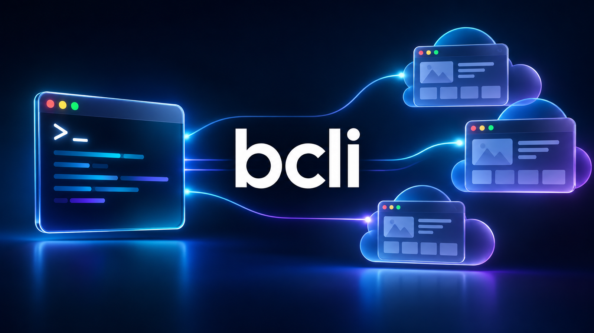

<p align="center"></p>

**bcli v0.14.0-rc.1** is the first public release candidate of the command-line client for
[servas.ai](https://servas.ai) Browser as a Service: real, headed cloud browsers for your agents and tests, driven over
standard CDP — now for **Linux, macOS and Windows**.

## Highlights

- **Linux, macOS (Apple silicon) and Windows** — single executables, no dependencies.
- **OIDC sign-in** via `auth.servas.ai` (`bcli login`) — no VPN, no API keys.
- **One command to a real browser:** `bcli session create --wait` → `connectOverCDP(cdp_url)` → `bcli session stop`.
- **Live view and hand-over** in your own browser (`view_url`).
- **Persistent profiles**, **your own exit IP** ([baas-exit-docker](https://github.com/servas-ai/baas-exit-docker)),
  **localhost tunnels**, **GPU sessions**, **session audio**.
- **Local mode on every platform** with an encrypted credential vault and a bundled fill extension.
- **Agent-ready:** `agent-web` helper (bash + PowerShell) on top of agent-browser, a Claude Code skill and an
  `AGENTS.md` snippet in this repository.
- **Signed self-update** (`bcli update`).

## Install

| Platform | Asset |
|---|---|
| Linux x86-64 | `bcli-linux-amd64` |
| Linux ARM64 | `bcli-linux-arm64` |
| macOS Apple silicon | `bcli-darwin-arm64` |
| Windows x86-64 | `bcli-windows-amd64.exe` |
| Windows ARM64 | `bcli-windows-arm64.exe` |
| Credential extension | `<CREDEXT_ASSET_NAME>` (SHA-256 `<CREDEXT_SHA256>`) |

`agent-web` helper: `agent-web` (Linux/macOS), `agent-web.ps1` + `agent-web.cmd` (Windows).

Step-by-step instructions for every OS: [docs/installation.md](https://github.com/servas-ai/bcli-public/blob/main/docs/installation.md).

```bash
# Linux example
VERSION=v0.14.0-rc.1; ARCH=amd64
curl -fsSLO https://github.com/servas-ai/bcli-public/releases/download/$VERSION/bcli-linux-$ARCH
curl -fsSLO https://github.com/servas-ai/bcli-public/releases/download/$VERSION/SHA256SUMS
grep " bcli-linux-$ARCH\$" SHA256SUMS | sha256sum --check -
install -D -m 0755 bcli-linux-$ARCH ~/.local/bin/bcli
```

## Verify

Always check the binary against `SHA256SUMS` (Linux `sha256sum`, macOS `shasum -a 256`, Windows `Get-FileHash`).
<!-- If SHA256SUMS.sig is attached: --> `SHA256SUMS.sig` is the Ed25519 signature of `SHA256SUMS` with the servas.ai CLI
release key ([keys/bcli-release-ed25519.pem](https://github.com/servas-ai/bcli-public/blob/main/keys/bcli-release-ed25519.pem)).

## Get started

```bash
bcli env add cloud --kind cloud --endpoint https://api.baas.servas.ai && bcli env use cloud
bcli login
bcli session create --wait
```

## Known limitations

- Release candidate: please report problems via [Issues](https://github.com/servas-ai/bcli-public/issues).
- macOS binary not notarized (remove the quarantine flag after verifying the checksum); Windows binary not
  Authenticode-signed (SmartScreen may warn).
- Local mode on Linux and macOS needs `browser_path` / `BAAS_BROWSER_PATH` pointing to a Chromium-based browser.

## Checksums

```text
<PASTE CONTENT OF SHA256SUMS HERE>
```

Full changelog: [CHANGELOG.md](https://github.com/servas-ai/bcli-public/blob/main/CHANGELOG.md)
